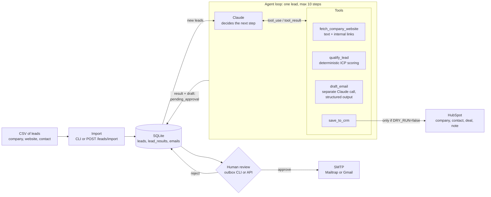

# AI Sales Agent (AI SDR)

An autonomous sales development agent built on Claude. Give it a list of companies and it researches
each one's website, scores it against an Ideal Customer Profile (ICP), writes a personalized cold
email grounded in facts it found, and records the result in HubSpot. **A human approves every email
before it is sent**, so the agent does the research and the writing and a person makes the
irreversible decision.

Python 3.12 · FastAPI · Anthropic SDK (tool calling, structured outputs) · Pydantic · SQLAlchemy/SQLite ·
httpx · HubSpot CRM API · SMTP · pytest · Docker

## Architecture



**One lead, step by step:** the agent fetches the homepage and, if facts are missing, picks
about/careers pages from the extracted links → extracts facts plus evidence for each ICP signal →
`qualify_lead` scores them with transparent rules → for hot/warm leads `draft_email` writes an email
from that evidence only → `save_to_crm` upserts HubSpot → the draft waits in SQLite as
`pending_approval` until a person approves or rejects it.

## Example run (real output)

All 10 companies in [`data/sample_leads.csv`](data/sample_leads.csv) (public Danish B2B companies,
fake `@example.com` contacts) in `DRY_RUN` mode, with `claude-sonnet-5-5` at effort `medium`:

```bash
uv run python -m app.cli run data/sample_leads.csv
```

| Company | Fit | Score | Why (from the agent's evidence) |
|---|---|---|---|
| Pleo | hot | 93 | software, DK, 850 employees, hiring in finance, 8 new offices + Series C |
| LEMAN | warm | 58 | logistics, DK, added 161 trailers in April 2026; headcount not on the site |
| Dixa | warm | 58 | software, DK, $105M Series C, two acquisitions; headcount not on the site |
| Visma e-conomic | warm | 50 | software, DK; no buying signals found |
| Templafy | warm | 50 | software, DK; no buying signals found |
| DSV | cold | 28 | listed company that acquired Schenker → `enterprise_scale` −30 |
| Columbus | cold | 28 | ~1,600 employees, listed since 1998 |
| Blue Water Shipping | cold | 20 | 2,500+ employees, 80+ offices in 30+ countries |
| Scan Global Logistics | cold | 8 | 5,100 employees, 200+ offices; HQ country not found on the pages read |
| Netcompany | cold | 8 | 9,500+ employees (see the limitations for a misapplied signal) |

```json
{
  "total": 10,
  "by_status": { "completed": 10 },
  "by_fit": { "hot": 1, "warm": 4, "cold": 5 },
  "usage": {
    "input_tokens": 4446,
    "output_tokens": 14960,
    "cache_read_input_tokens": 457379,
    "cache_creation_input_tokens": 142765,
    "total_input_tokens": 604590
  }
}
```

10 leads in 2 min 46 s, no failures, 5 drafts waiting for approval. 76% of input tokens were prompt-cache
reads; the run cost about **$0.61** at list prices (~$0.06 per lead). Cold leads are cheaper because
no email is written.

<details>
<summary>Trace of one lead (Pleo): agent steps, the email it wrote, and its summary</summary>

```text
Step 1/10: stop_reason=tool_use tokens in=4934 (cached 0, cache_write 4930) out=59
  -> fetch_company_website({"url": "https://www.pleo.io"})
Step 2/10: stop_reason=tool_use tokens in=8143 (cached 4930, cache_write 3211) out=170
  -> fetch_company_website({"url": "https://www.pleo.io/en/about"})      <- two pages in parallel,
  -> fetch_company_website({"url": "https://www.pleo.io/en/careers"})       chosen from the links
Step 3/10: -> qualify_lead(...)   <- score 93, hot
Step 4/10: -> draft_email(...)
Step 5/10: -> save_to_crm(...)    <- DRY_RUN: logged, nothing written
Step 6/10: stop_reason=end_turn
```

Qualification reasons:
```text
+30: target industry (software)
+25: 850 employees is in range
+20: target country (DK)
+10: Company is hiring finance or accounting roles (Open role: Billing Operations Analyst (Maternity Cover) in Lisbon, Finance team)
+8: Recent funding, acquisition, new offices or international expansion (Expanded from Copenhagen HQ to offices in London, Berlin, Stockholm, Madrid, Lisbon, Paris, Amsterdam and Chennai; record-breaking Series C round)
```

Email draft (`pending_approval`, to the contact from the CSV):
```text
Subject: Finance workflows across Pleo's growing offices

Hi Test,

Pleo has grown from its Copenhagen HQ into offices across London, Berlin, Stockholm, Madrid, Lisbon,
Paris, Amsterdam and Chennai, and you're now hiring a Billing Operations Analyst for the Lisbon
finance team.

With that many locations, invoice approvals and month-end close tend to demand more manual chasing
and reconciliation as the team grows.

Fjordflow automates invoice approval and month-end close for mid-sized Nordic companies, cutting
manual finance work by up to 60%. It integrates with e-conomic, Microsoft Dynamics and NetSuite.

Would you be open to a 20-minute call to see whether it could help your finance team?

Best regards,
Mette Jensen
Account Executive, Fjordflow ApS
```

From the agent's summary:
> Pleo sells a product that competes with Fjordflow, so the deal may be harder than the score
> suggests. I did not log a `has_competitor` signal because that signal means a company *uses* a
> competing tool, and I found no evidence that Pleo does.

</details>

**What this run shows, including what went wrong.** Pleo scored *hot* although it sells spend
management, which makes it closer to a competitor than a customer. The ICP only penalizes companies that
*use* a competing tool, so the rules let it through. The agent noticed and said so in its summary, and
this is exactly the kind of case the human approval step is there to catch. See
[Limitations](#limitations-and-what-to-improve).

## Key design decisions

- **Own agent loop instead of a framework.** `app/agent/loop.py` is ~250 lines: send messages with tool
  definitions, execute the `tool_use` blocks, return all results in one message, repeat until
  `end_turn` or the step limit. With no framework in between, every step, token count and error is
  visible in the logs, tests can script the model's responses, and there's nothing to debug except our own code.
- **The model extracts, code decides.** Claude reads the website and fills in facts plus *evidence*
  for each ICP signal. The score is plain Python driven by [`config/icp.yaml`](config/icp.yaml), so
  the same facts always give the same score and every point traces back to a sentence on the site.
- **Human-in-the-loop for sending.** The agent has no send tool at all. Drafts are stored as
  `pending_approval`; only `app/outbox.py` (CLI or `POST /leads/{id}/approve`) can send, records who
  approved, and refuses to send twice or to email a company that was already contacted. A sent email
  can't be taken back, a bad one costs a lead and domain reputation, and review takes a minute. Not
  giving the agent a send tool is also a structural defense against prompt injection from scraped websites.
- **`DRY_RUN=true` by default.** HubSpot writes and SMTP sends are logged as "would send" payloads.
  Real side effects need an explicit `DRY_RUN=false`.
- **Retries and idempotency.** The HubSpot client retries 429/5xx with exponential backoff and honors
  `Retry-After`; 401/403 fail fast with clear messages. Companies are upserted by domain, contacts by
  email (a 409 on create is resolved by re-searching), deals by name, so re-running a lead updates
  instead of duplicating.
- **Email writing is a separate Claude call** with a focused prompt and structured output
  (`messages.parse` → Pydantic model). It only sees verified facts; the signature is appended by code.
- **Cost-aware.** Prompt caching on the growing conversation, token usage logged per step and summed
  per lead and batch, and cold leads stop before the email step.

## Quick start

### With Docker
```bash
cp .env.example .env              # set ANTHROPIC_API_KEY; keep DRY_RUN=true
docker compose up --build         # API on http://localhost:8000/docs
docker compose run --rm api python -m app.cli run data/sample_leads.csv --limit 2
```
`./data` is mounted into the container, so the SQLite database survives restarts. `.env` is passed at
runtime and never copied into the image.

### Locally with uv
```bash
uv sync
cp .env.example .env              # set ANTHROPIC_API_KEY
uv run pytest
uv run python -m app.cli run data/sample_leads.csv --limit 2
uv run uvicorn app.main:app --reload
```

## Configuration

All settings come from environment variables / `.env` (see [`.env.example`](.env.example)).

| Variable | Default | Purpose |
|---|---|---|
| `ANTHROPIC_API_KEY` | – | Claude API key |
| `ANTHROPIC_MODEL` | `claude-opus-5-5` | model for the agent and the email writer |
| `ANTHROPIC_EFFORT` | `medium` | reasoning effort: `low` … `max` |
| `AGENT_MAX_STEPS` | `10` | max model calls per lead |
| `ICP_PATH` | `config/icp.yaml` | Ideal Customer Profile and scoring weights |
| `FETCH_MAX_CHARS` | `8000` | max page text passed to the model |
| `HTTP_TIMEOUT_SECONDS` | `10` | timeout for website, HubSpot and SMTP calls |
| `DRY_RUN` | `true` | when true, nothing is written to HubSpot and no email is sent |
| `DATABASE_URL` | `sqlite:///data/app.db` | SQLAlchemy URL |
| `HUBSPOT_TOKEN` | – | HubSpot service key |
| `HUBSPOT_PIPELINE` / `HUBSPOT_DEAL_STAGE` | `default` / `appointmentscheduled` | where deals are created |
| `HUBSPOT_MAX_RETRIES` | `3` | retries on 429/5xx |
| `SMTP_HOST` / `SMTP_PORT` / `SMTP_USER` / `SMTP_PASSWORD` / `SMTP_FROM` | – / `587` | SMTP server |
| `SMTP_USE_SSL` | `false` | implicit TLS (port 465) instead of STARTTLS |
| `EMAIL_REDIRECT_TO` | – | testing safety net: send every approved email here instead |
| `LOG_LEVEL` | `INFO` | logging level |

## Usage

### CLI
```bash
uv run python -m app.cli run data/sample_leads.csv [--limit N]   # import + run all new leads
uv run python -m app.cli import data/my_leads.csv                # import only
uv run python -m app.cli leads --fit warm --status pending_approval
uv run python -m app.agent "Company" https://company.example     # one company, full log
```
CSV columns: `company_name` (or `name`), `website`, optional `contact_name`, `contact_email`.
Comma or semicolon separated (Excel exports work). One failing lead never stops a batch; it stays
`new` and is retried next time.

### HTTP API
Interactive docs at `/docs`.

| Method | Path | What it does |
|---|---|---|
| `POST` | `/leads/import` | upload a CSV (multipart field `file`) |
| `GET` | `/leads?fit=hot&status=pending_approval` | list leads, best score first |
| `GET` | `/leads/{id}` | lead + latest email draft + qualification reasons |
| `POST` | `/leads/{id}/run` | run the agent on one lead (~20 s) |
| `POST` | `/leads/run-batch?limit=10` | run the agent on all `new` leads, one by one |
| `POST` | `/leads/{id}/approve` | `{"reviewer": "...", "to": "optional"}`: send the pending email |
| `POST` | `/leads/{id}/reject` | `{"reviewer": "..."}`: reject the pending email |

### Review and send emails
```bash
uv run python -m app.outbox list                           # drafts waiting for approval
uv run python -m app.outbox show 1                         # email + why the lead qualified
uv run python -m app.outbox approve 1 [--to anna@company.com] [--by name]
uv run python -m app.outbox reject 1
```

| Lead status | Email status |
|---|---|
| `new` → `qualified` / `disqualified` → `pending_approval` → `sent` | `pending_approval` → `sent` / `rejected` / `failed`, or `superseded` by a newer draft |

## Integrations setup

<details>
<summary>HubSpot (free account, service key)</summary>

1. Create a free account at https://www.hubspot.com (Free CRM).
2. **Development → Keys → Service keys → Create service key** (older accounts: a private app under
   **Development → Legacy apps**; its token works the same way).
3. Scopes:

   | Scope | Used for |
   |---|---|
   | `crm.objects.companies.read` / `.write` | find a company by domain / create it |
   | `crm.objects.contacts.read` / `.write` | find a contact by email / create contacts and notes |
   | `crm.objects.deals.read` / `.write` | find / create and update deals |
   | `crm.schemas.deals.read` / `.write` | check / create the custom deal properties |

4. Put the key in `.env` as `HUBSPOT_TOKEN`. Check it (read-only):
   ```bash
   uv run python -c "from app.config import get_settings; from app.integrations.hubspot import HubSpotClient; c = HubSpotClient.from_settings(get_settings()); print('OK, company id:', c.search('companies', 'domain', 'example.com'))"
   ```
5. Run one company with `DRY_RUN=false`. The first run creates the deal properties **AI lead score**
   and **AI lead fit**; you'll see a company, a deal `"<Company> - AI SDR"` with score and fit, a note
   with the email draft and, if known, a contact. Custom properties are hidden by default: on a deal
   use **View all properties**, in the deals table use **Edit columns**.

Troubleshooting: `401` wrong or rotated key · `403` missing scope · `429` retried automatically ·
`400` on deal stage: set `HUBSPOT_DEAL_STAGE` to a stage ID from **Settings → Objects → Deals → Pipelines**.
</details>

<details>
<summary>SMTP (Mailtrap for testing, or Gmail)</summary>

**Mailtrap (recommended):** a sandbox inbox that never delivers to real people. In
**Email Testing → Inboxes → SMTP** copy the credentials:
```
SMTP_HOST=sandbox.smtp.mailtrap.io
SMTP_PORT=2525
SMTP_USER=<username>
SMTP_PASSWORD=<password>
SMTP_FROM=sdr@example.com
```
**Gmail:** enable 2-Step Verification, create an App Password, use `smtp.gmail.com:587` with your
Gmail address as `SMTP_USER` and `SMTP_FROM`, and set `EMAIL_REDIRECT_TO` to your own address so no
real recipient is emailed while testing.
</details>

## Tests

```bash
uv run pytest        # 76 tests, no network
uv run ruff check .
uv run mypy app      # strict
```
The agent loop runs against a scripted fake Claude client; HubSpot HTTP is mocked with `respx`
(including 429 retries, 409 duplicates, 401); SMTP uses a fake server; the API is tested through
FastAPI's `TestClient` with dependency overrides. Covered: CSV parsing (BOM, semicolons, duplicates),
ICP scoring rules, lead and email status transitions, and the approval rules.

## Project structure

```
app/
  agent/          loop.py (tool-calling loop), prompts.py, __main__.py (single-company CLI)
  tools/          fetch_company_website, qualify_lead, draft_email, save_to_crm
  integrations/   hubspot.py (CRM client with retries), email.py (SMTP)
  api/            FastAPI routes (leads.py) and dependencies (deps.py)
  models/         Pydantic models: leads, ICP, API schemas, statuses
  pipeline.py     shared service layer used by the API and the CLI
  storage.py      SQLAlchemy models: leads, lead_results (run log), emails
  outbox.py       human review: the only code path that sends email
  cli.py          import / run / leads
config/icp.yaml   Ideal Customer Profile, signals and scoring weights
data/             sample_leads.csv (committed); your CSVs and app.db are gitignored
tests/            pytest suite
```

## Limitations and what to improve

Things I'd fix before using this for real outreach:

- **ICP blind spots.** Pleo scored *hot* in the example run while selling a competing product: the
  ICP penalizes companies that *use* a competitor, not ones that *are* one. Netcompany got the
  `public_sector` penalty because its *customers* are public agencies. Both need sharper signal
  definitions and an evaluation set of labeled companies to measure scoring accuracy, instead of
  judging it by eye.
- **Website-only research.** Headcount is often missing (5 of 10 sample companies), JavaScript-heavy
  sites return little text, and pages are truncated at 8,000 characters. Company registries (e.g. the
  Danish CVR) or LinkedIn data would give reliable size and HQ country.
- **Scoring weights are hand-tuned** and thresholds (hot ≥ 70, warm ≥ 40) aren't calibrated against
  real conversion data.
- **No automated quality check for emails.** There's no eval or LLM-as-judge for tone, accuracy and
  hallucinations; the human reviewer is the only check. Model output also varies between runs.
- **No authentication on the API.** Anyone who can reach it can approve emails. Needs auth and
  per-user audit before it leaves localhost.
- **Synchronous runs.** `run-batch` blocks the request (~17 s per lead); a job queue (e.g. Celery/RQ
  or arq) with progress tracking is the production version. Leads are also processed one at a time.
- **SQLite and no migrations.** Fine for a single user; Postgres plus Alembic migrations for anything
  shared (a schema change currently means recreating `data/app.db`).
- **Compliance and outreach basics are missing:** no unsubscribe link or suppression list, no GDPR
  handling of contact data, no follow-up sequences, no reply tracking.
- **HubSpot legacy v3 API** (supported until September 2027); the date-based API is the migration target.
- **Cost:** prompt-cache *writes* are the largest cost item; caching the stable system prompt and
  tool definitions across leads more aggressively would cut it further.
